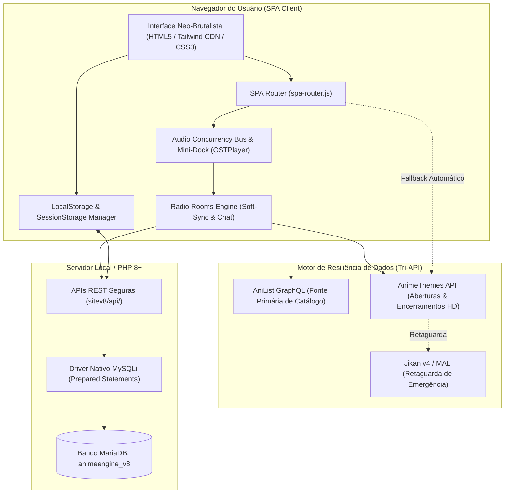

<div align="center">

# ⚡ ANIMEENGINE v8 ⚡
### *A Plataforma Definitiva de Catálogo, Rádio Sincronizada & Gamificação de Animes*

[](https://github.com/KauaVReis/animeEngine)
[](https://github.com/KauaVReis/animeEngine)
[](https://graphql.anilist.co)
[](https://animethemes.moe)
[-777bb4?style=for-the-badge&logo=php&logoColor=white)](https://php.net)
[](LICENSE)

<br/>

> **AnimeEngine v8** é uma evolução completa do projeto, combinando uma experiência de **Single Page Application (SPA)** ultra-fluida, uma **Rádio Social Colaborativa (Radio Rooms)** com áudio persistente, minijogos diários de adivinhação musical (**Animdle**), e um motor de resiliência de dados com **AniList GraphQL** e **AnimeThemes HD**.

---

</div>

<br/>

## 🎯 Destaques e Inovações do v8

```
┌──────────────────────────────────────────────────────────────────────────┐
│  ⚡ SPA 100% PERSISTENTE   │  Áudio ininterrupto durante toda a navegação │
│  📻 RADIO ROOMS            │  Salas de escuta com chat ao vivo e soft-sync│
│  🎵 ANIMDLE ARCADE         │  Desafio diário de adivinhação de Openings   │
│  🧮 CALCULADORA DE MISSÃO  │  Import de backlog, ritmo diário & fillers   │
│  📅 CALENDÁRIO DA ESTAÇÃO  │  Grade de transmissão, modo dia & countdown  │
│  🎨 ESTILO NEO-BRUTALIST   │  Bordas sólidas, sombras duras & +15 temas   │
└──────────────────────────────────────────────────────────────────────────┘
```

---

## 🏛️ Arquitetura do Sistema

O AnimeEngine v8 opera sobre uma arquitetura híbrida de alto desempenho: frontend moderno com SPA Vanilla JS gerenciada por barramento de eventos e persistência de mídia, integrado a um backend PHP moderno, seguro e transacional:



---

## ✨ Funcionalidades Principais

### 📻 1. AnimeEngine Radio Rooms (Salas de Rádio Coletiva)
- **Salas Públicas & Privadas:** Crie e compartilhe salas musicais temáticas ou privadas com código de acesso.
- **Sincronização em Tempo Real (Soft-Sync):** Todos os participantes ouvem a mesma música na mesma posição de tempo através de sincronização de relógio de servidor.
- **Fila Administrada:** O anfitrião adiciona, remove e organiza a fila musical da sala em tempo real.
- **Chat Interativo & Reações:** Mensagens instantâneas, logs de eventos de entrada/saída e reações rápidas.
- **Mini-Dock Persistente:** Continue navegando por todo o site enquanto a música da sala toca ininterruptamente no dock inferior.

### 🎵 2. Animdle (O Jogo Musical Diário)
- **Desafio Diário por Semente:** Nova trilha sonora oficial de anime sorteada todos os dias à meia-noite.
- **Progressão de Dicas:** Comece ouvindo 1 segundo do áudio e desbloqueie trechos adicionais (2s, 4s, 7s, 11s, 16s) a cada tentativa.
- **Sistema de Streak & XP:** Ganhe experiência, suba de nível e registre suas vitórias no perfil.

### 🧮 3. Calculadora de Maratona & Planejador de Missão
- **Importação Rápida:** Puxe com um clique todos os animes da sua lista *"Assistindo"* ou *"Planejo Assistir"*.
- **Presets de Ritmo de Vida:**
  - ☕ *Casual:* 1 ep/dia (~20 min)
  - 📺 *Padrão:* 3 eps/dia (~1 hora)
  - 🔥 *Otaku:* 6 eps/dia (~2 horas)
  - ⚡ *Hardcore:* 12 eps/dia (~4 horas)
- **Calculadora Reversa por Prazo:** Defina uma data-limite (ex: *"quero terminar antes do Natal"*) e o sistema calcula a meta diária necessária.
- **Detecção de Fillers (`AnimeData`):** Filtra automaticamente episódios fillers de clássicos como Naruto, Bleach e One Piece, calculando horas economizadas.
- **Cartão de Maratona:** Gerador de cartão com visual Neo-Brutalist pronto para compartilhar em redes sociais e WhatsApp.

### 📅 4. Calendário da Temporada
- **Grade Semanal Completa:** Visualização em 7 colunas (Domingo a Sábado) com status `🔴 NO AR` e contagem regressiva ao vivo.
- **Modo Dia para Mobile:** Abas rápidas por dia da semana (`Dom` a `Sáb`) para navegação confortável em celulares.
- **Busca em Tempo Real:** Filtre instantaneamente qualquer anime da temporada enquanto digita.
- **Seletor de Estação Interativo:** Salte entre Inverno, Primavera, Verão e Outono com navegação rápida de ano.

### 👤 5. Perfil, Conquistas & Gamificação
- **Sincronização com AniList:** Puxe seu avatar, banner e biografia do seu perfil AniList oficial.
- **Seleção de Waifu/Husbando:** Pesquise e fixe seu personagem favorito da AniList diretamente no topo do seu perfil.
- **Molduras & Cores de Nome:** Desbloqueie customizações cosméticas Neo-Brutalistas conforme ganha níveis e completa metas.
- **Galeria de Títulos & Medalhas:** Títulos e conquistas desbloqueáveis com persistência segura no banco de dados.

---

## 🎨 Design System: Neo-Brutalismo Vibrante

O visual do AnimeEngine v8 é construído sobre a estética **Neo-Brutalist**, priorizando personalidade, legibilidade e alto contraste:

- **Bordas Marcantes:** Traços sólidos de 2px a 3px com cantos afiados.
- **Sombras Duras:** Sombras de projeção sólida (`box-shadow: 4px 4px 0 #000000`).
- **Paleta de Alto Contraste:** Cores vibrantes com garantia de contraste rigorosa em todos os modos.
- **Seletor de Temas Dinâmico:**
  - `Default Cyberpunk` (Laranja / Roxo Neon)
  - `Mono High-Contrast` (Preto & Branco Brutalista)
  - `Manga Mode` (Leve, estilo papel com contraste otimizado)
  - `Vaporwave`, `Vesta Mode`, `Zen Mode` e mais de 10 temas secretos desbloqueáveis através de códigos no buscador!

---

## 📁 Estrutura de Diretórios

```bash
animeengine/
├── sitev8/                       # ⭐ Versão Principal Oficial (SPA v8)
│   ├── api/                      # Endpoints REST (mysqli seguro)
│   │   ├── auth/                 # Login, cadastro, logout, sessão
│   │   ├── lists/                # Adicionar, atualizar, excluir animes da lista
│   │   ├── radio/                # Sync, chat, salas, fila musical de Radio Rooms
│   │   └── users/                # Atualização de perfil, avatar, waifu
│   ├── css/                      # Estilos Neo-Brutalistas
│   │   ├── pages/                # CSS modular por página (radio, calculadora, etc.)
│   │   ├── v6_styles.css         # Variáveis de temas e garantias de contraste
│   │   └── style.css             # Base compartilhada
│   ├── js/                       # Camada JavaScript do Cliente
│   │   ├── core/                 # SPA Router e ciclo de vida
│   │   ├── pages/                # Controladores das páginas (home, radio, etc.)
│   │   ├── services/             # MusicService (AnimeThemes HD)
│   │   ├── api.js                # Orquestrador Tri-API (AniList GraphQL)
│   │   └── storage.js            # Armazenamento e sincronização local
│   ├── views/                    # Componentes PHP da SPA
│   │   ├── home.php              # Hero spotlight, rails e command hub
│   │   ├── radio.php             # Rádio temática & salas ao vivo
│   │   ├── calculadora.php       # Planejador de maratona
│   │   ├── calendario.php        # Grade de transmissões
│   │   └── editar_perfil.php     # Editor de perfil com AniList
│   └── database/                 # Scripts SQL de criação do banco v8
├── sitev7/                       # Versão histórica v7
├── versoesPassadas/              # Arquivo histórico (v1 até v6)
└── .agents/                      # Sistema de orquestração multiagentes (AG Kit)
```

---

## 🛠️ Tecnologias Utilizadas

| Camada | Tecnologia | Descrição |
|---|---|---|
| **Linguagem Backend** | PHP 8.x | Execução nativa ultrarrápida |
| **Banco de Dados** | MariaDB / MySQL | Relacional com `mysqli` preparado |
| **Segurança** | Prepared Statements (`bind_param`) | 100% livre de injeção SQL, zero PDO |
| **Frontend Core** | Vanilla JavaScript (ES2022+) | Zero overhead de frameworks pesados |
| **Roteamento** | SPA Router Nativo | Navegação instantânea com histórico |
| **Estilização** | CSS3 + Tailwind CDN | Neo-Brutalismo com variáveis CSS |
| **APIs Externas** | AniList GraphQL + AnimeThemes REST | Metadados oficiais e mídias musicais HD |

---

## 🚀 Como Executar Localmente

### 1. Pré-requisitos
- **XAMPP / WAMP / Docker** com **PHP 8.0+** e **MySQL/MariaDB**.
- Navegador moderno com suporte a Fetch API e Web Audio.

### 2. Configuração do Banco de Dados
1. Inicie os módulos **Apache** e **MySQL** no seu painel XAMPP.
2. Abra o phpMyAdmin (`http://localhost/phpmyadmin/`).
3. Crie um banco de dados chamado **`animeengine_v8`**.
4. Importe os arquivos de schema localizados em `sitev8/database/`:
   - `animeengine_v8_setup.sql` (Estrutura principal de usuários, listas e histórico)
   - `radio_rooms_schema.sql` (Estrutura de salas, participantes, chat e fila)

### 3. Execução
1. Clone o repositório dentro do diretório `htdocs` do seu servidor:
   ```bash
   cd C:\xampp\htdocs
   git clone https://github.com/KauaVReis/animeEngine.git animeengine
   ```
2. Verifique o arquivo de configuração de banco de dados em `sitev8/includes/database.php` (configurado por padrão com usuário `root` e senha vazia).
3. Abra seu navegador e acesse:
   ```
   http://localhost/animeengine/sitev8/
   ```

---

## 🔒 Segurança e Boas Práticas

- **Prepared Statements Obrigatórios:** Todas as consultas no banco utilizam `mysqli_prepare` com `bind_param`, garantindo total imunidade a SQL Injection.
- **Content Security Policy (CSP) Reforçada:** Cabeçalhos estritos configurados no `.htaccess` autorizando exclusivamente as APIs oficiais (AniList, AnimeThemes, YouTube Embed).
- **Sem Dependências Desnecessárias:** Código limpo, leve e manutenível que roda diretamente em qualquer servidor Apache comum sem necessidade de build complexo.

---

<div align="center">

Desenvolvido por **[Kaua Vitor Reis](https://github.com/KauaVReis)**  
*AnimeEngine — Onde a paixão por animes encontra engenharia de software de ponta.*

</div>
